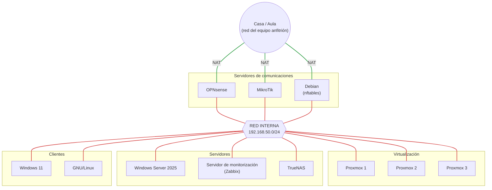

# Configuración básica de red

Este apartado explica cómo se simula la red de la empresa dentro de **VirtualBox**:

- Una **red interna** hace de **LAN** de la empresa.
- Un adaptador en modo **NAT** hace de **salida al exterior** (WAN).

---

## 1. Esquema del montaje individual



**Leyenda:** en verde, las conexiones WAN (adaptador en modo NAT hacia la red de casa o del aula). En rojo, las conexiones a la red interna (LAN).

### Elementos y conexiones

| Elemento | Función | Adaptador 1 | Adaptador 2 |
|---|---|---|---|
| OPNsense | Servidor de comunicaciones | NAT (WAN) | Red interna (LAN) |
| MikroTik | Servidor de comunicaciones | NAT (WAN) | Red interna (LAN) |
| Debian (nftables) | Servidor de comunicaciones | NAT (WAN) | Red interna (LAN) |
| Proxmox 1, 2 y 3 | Nodos de virtualización (clúster) | Red interna | — |
| Windows Server 2025 | Dominio (Active Directory) y DNS | Red interna | — |
| Servidor de monitorización | Zabbix | Red interna | — |
| TrueNAS | Almacenamiento y copias de seguridad | Red interna | — |
| Windows 11 | Cliente | Red interna | — |
| GNU/Linux | Cliente | Red interna | — |

- La red interna usa el direccionamiento **192.168.50.0/24**. El enunciado pide 192.168.XX.0/24, donde XX es la posición del equipo en el aula: en mi caso, 50.
- Solo los **servidores de comunicaciones** tienen dos adaptadores. El resto de máquinas tiene un único adaptador en la red interna, así que para salir al exterior tienen que pasar obligatoriamente por uno de ellos.
- La WAN funciona igual **en casa que en el aula**, porque el modo NAT sale por la conexión que tenga el equipo anfitrión en cada momento.

---

## 2. Modos de red de VirtualBox

| Modo | Qué hace | ¿Lo usamos? |
|---|---|---|
| **NAT** | La VM sale al exterior a través de la conexión del anfitrión. VirtualBox le da una IP privada por DHCP y la VM no es visible desde fuera. | **Sí**, para la WAN del servidor de comunicaciones |
| **Red interna** | Red aislada que solo comunica entre sí las VM conectadas a ella con el mismo nombre. No llega al anfitrión ni al exterior. | **Sí**, para la LAN de la empresa |
| Red NAT | Como NAT, pero varias VM comparten la misma red y se ven entre ellas. | No |
| Adaptador puente | La VM se conecta directamente a la red física del anfitrión, como un equipo más del aula. | No (opcional si el profesorado lo pide) |
| Solo-anfitrión | Red privada entre las VM y el anfitrión, sin salida al exterior. | No |

---

## 3. Por qué esta configuración

### Red interna para la LAN

- **Aislamiento**: la LAN queda separada del anfitrión, de la red del aula y de las demás redes. Se comporta como el commutador de la empresa, al que solo se conectan sus equipos.
- **Camino de tráfico controlado**: la única salida al exterior es el servidor de comunicaciones, que es quien enruta, hace NAT y filtra. Así se puede demostrar qué conexiones se permiten y cuáles se bloquean.
- **Sin interferencias en el aula**: el servidor DHCP de la LAN solo existe dentro de la red interna. Se cumple la norma del enunciado de no lanzar un DHCP de pruebas sobre la red compartida.

### NAT para la salida externa

- **La IP se obtiene por DHCP**: el enunciado permite que la IP del servidor de comunicaciones del entorno individual se obtenga por DHCP. En modo NAT la asigna VirtualBox automáticamente.
- **Funciona en cualquier sitio**: no depende de la red física, así que el entorno funciona igual en el aula que en casa.
- **Seguridad**: la WAN no es accesible desde la red del aula. Solo sale el tráfico que inicia el servidor de comunicaciones.

---

## 4. Configuración en VirtualBox

### Servidores de comunicaciones (OPNSense, MikroTik, DebianServidorComunicaciones)

*Configuración → Red*

| Adaptador | Habilitado | Conectado a | Nombre | Uso |
|---|---|---|---|---|
| Adaptador 1 | Sí | NAT | — | WAN |
| Adaptador 2 | Sí | Red interna | `LAN50` | LAN |

### Resto de máquinas (servidores y clientes)

| Adaptador | Habilitado | Conectado a | Nombre | Uso |
|---|---|---|---|---|
| Adaptador 1 | Sí | Red interna | `LAN50` | LAN |

> **Importante:** el nombre de la red interna (`LAN50`) tiene que escribirse exactamente igual en todas las máquinas, respetando mayúsculas y minúsculas. Si no coincide, VirtualBox crea una red interna distinta y las máquinas no se ven.

### Equivalente por línea de comandos

```bash
# Servidor de comunicaciones
VBoxManage modifyvm "OPNSense" --nic1 nat --nic2 intnet --intnet2 "LAN50"

# Cualquier otra máquina de la LAN
VBoxManage modifyvm "NombreMaquina" --nic1 intnet --intnet1 "LAN50"
```

---

## 5. Funciones del servidor de comunicaciones en esta red

Para que los equipos de la LAN tengan salida al exterior, el servidor de comunicaciones activo debe:

1. Tener configuradas las dos interfaces: WAN por DHCP y LAN con IP fija.
2. Reenviar paquetes entre interfaces (enrutamiento).
3. Hacer **NAT de salida** (enmascaramiento) de la LAN hacia la WAN.
4. Ofrecer **DHCP** en la LAN para los clientes.
5. Filtrar el tráfico con las reglas del cortafuegos.

> **Solo un servidor DHCP activo en la red interna.** Aunque los tres servidores de comunicaciones estén configurados, el DHCP solo debe estar activado en uno de ellos. Si no, los clientes recibirían configuraciones distintas al azar.

---

## 6. Limitaciones

- **Sin acceso directo desde el anfitrión**: el anfitrión no está en la red interna, así que las interfaces web de administración (OPNsense, Proxmox, TrueNAS…) se abren desde un cliente de la LAN.
- **Un único commutador virtual**: como en la arquitectura de referencia del enunciado, no hay redundancia de red.
- **Doble NAT**: el tráfico pasa por el NAT del servidor de comunicaciones y después por el de VirtualBox. Para navegar no supone ningún problema, pero no se pueden recibir conexiones desde fuera sin configurar el reenvío de puertos en VirtualBox.

---

## Fuentes consultadas

Fecha de consulta: 22/11/2026

| Tema | Fuente oficial |
|---|---|
| Modos de red de VirtualBox | <https://www.virtualbox.org/manual/topics/networkingdetails.html> |
